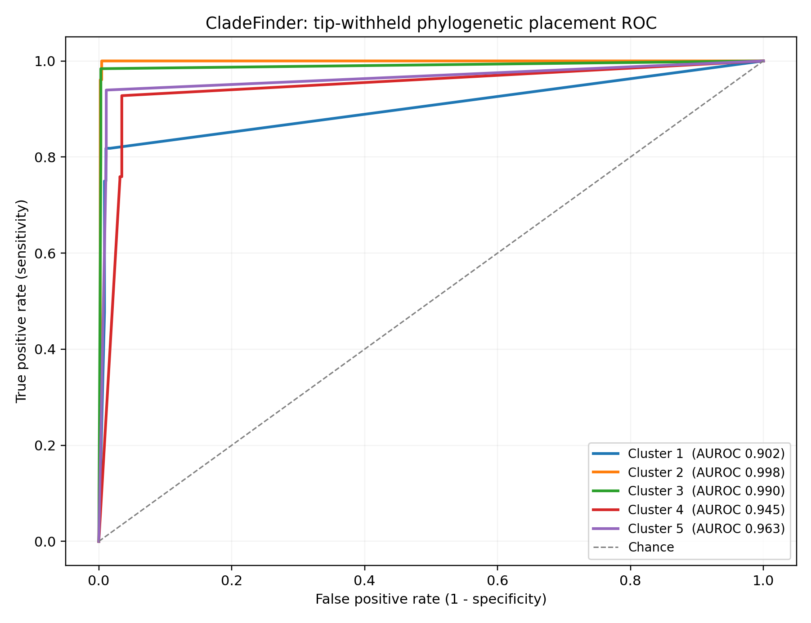
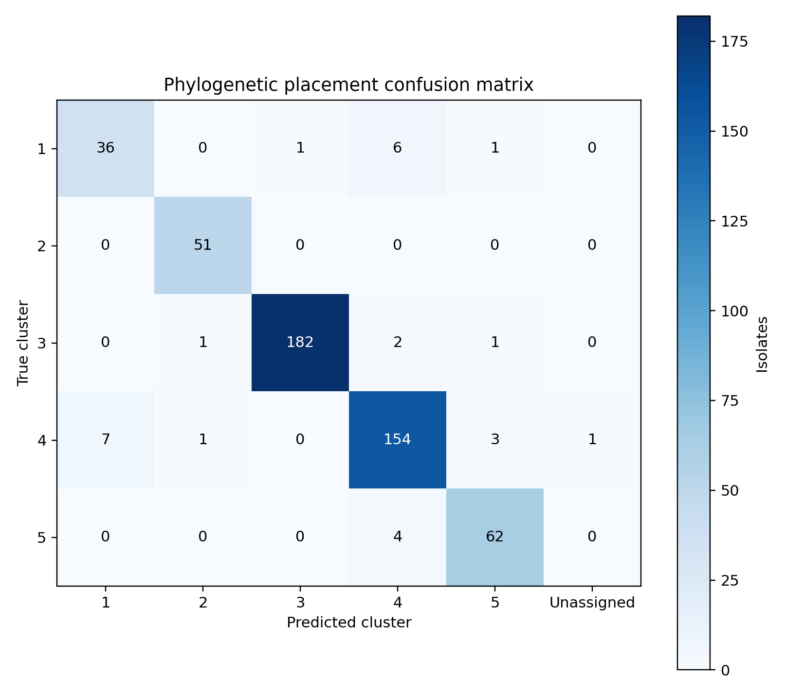
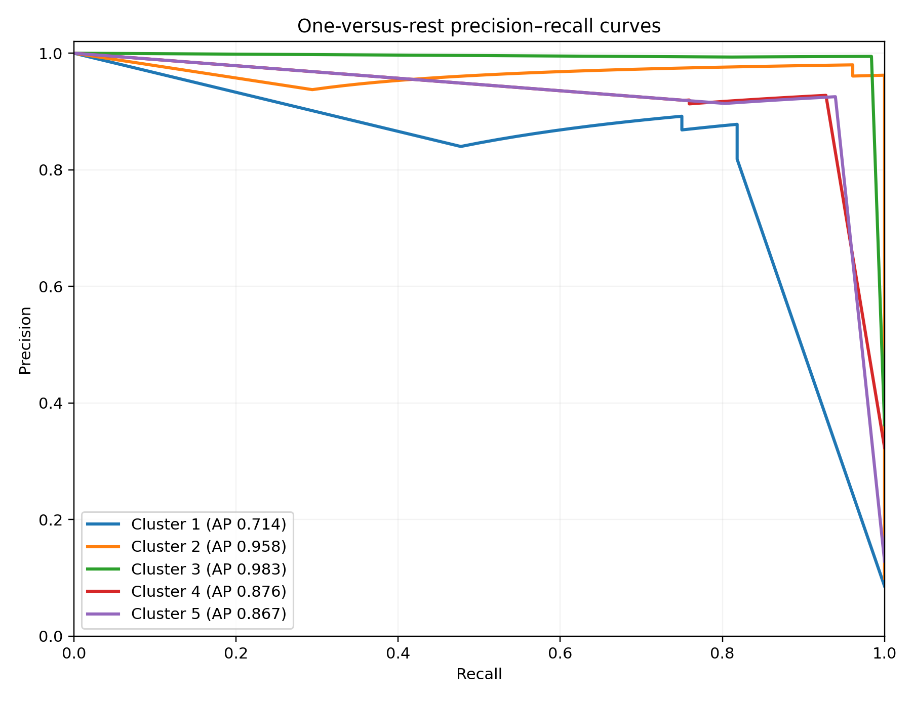

# CladeFinder full validation report

Tested: **513**; correct: **485**; assigned: **512**.

## Per-cluster performance

| Cluster | n | Correct | Sensitivity | AUROC |
|---|---:|---:|---:|---:|
| 1 | 44 | 36 | 81.8% | 0.902 |
| 2 | 51 | 51 | 100.0% | 0.998 |
| 3 | 186 | 182 | 97.8% | 0.990 |
| 4 | 166 | 154 | 92.8% | 0.945 |
| 5 | 66 | 62 | 93.9% | 0.963 |

## Confusion matrix

| True / predicted | 1 | 2 | 3 | 4 | 5 | Unassigned |
|---|---:|---:|---:|---:|---:|---:|
| 1 | 36 | 0 | 1 | 6 | 1 | 0 |
| 2 | 0 | 51 | 0 | 0 | 0 | 0 |
| 3 | 0 | 1 | 182 | 2 | 1 | 0 |
| 4 | 7 | 1 | 0 | 154 | 3 | 1 |
| 5 | 0 | 0 | 0 | 4 | 62 | 0 |

## Interpretation
- 485/513 (94.5%) correct; 512/513 (99.8%) assigned; 27 wrong and 1 unassigned.
- Cluster 1 has lowest sensitivity; cluster 2 has highest.
- Six cluster-1 isolates predicted cluster 4, seven cluster-4 isolates predicted cluster 1.
- Macro AUROC: 0.960.
- Compared with earlier forced SNP nearest-neighbour baseline (432/513; 84.2%), this is +53 correct / +10.3 percentage points; descriptive comparison only.

## Limitations
- The 20,000 SNP sites were selected using the full collection before leave-one-out testing; validation is not fully nested or independent.
- EPA-ng GTR+G differs from RAxML GTR+G+ASC_LEWIS ascertainment model.
- Placement likelihood weights are not calibrated probabilities.
- The ground truth labels originate from the same phylogenetic framework, potentially favoring tree-based prediction.
- Independent FASTQ sequencing validation is still required.

## Recommendations
- Independently validate on blinded FASTQ isolates.
- Investigate 27 misclassifications and the one unassigned isolate.
- Rebuild the SNP panel within training folds or validate on a genuinely held-out cohort.
- Resolve ascertainment model mismatch before interpreting likelihood weights as probabilities.
